---
# Preamble

## Author
author:
  name: Богаткина Алёна Александровна
  degrees: DSc
  email: 1132231437@pfur.ru
  affiliation:
    - name: Российский университет дружбы народов
      country: Российская Федерация
      postal-code: 117198
      city: Москва
      address: ул. Миклухо-Маклая, д. 6

## Title
title: Презентация по Лабораторной работе №6
subtitle: Компьютерный практикум по статистическому анализу данных
license: CC BY
date: 2026-11-16

## Generic options
lang: ru-RU
crossref:
  lof-title: Список иллюстраций
  lot-title: Список таблиц
  lol-title: Листинги

## Fonts
mainfont: DejaVu Sans
romanfont: DejaVu Sans
sansfont: DejaVu Sans
monofont: DejaVu Sans Mono
mainfontoptions: Ligatures=TeX
romanfontoptions: Ligatures=TeX
sansfontoptions: Ligatures=TeX,Scale=MatchLowercase
monofontoptions: Scale=MatchLowercase,Scale=0.9

## Formats
format:
### Pdf output format
  beamer:
    toc: true
    toc-title: Содержание
    number-sections: true
    colorlinks: false
    toc-depth: 2
    slide_level: 2
    aspectratio: 169
    section-titles: true
    theme: metropolis
    themeoptions: progressbar=frametitle,sectionpage=progressbar,numbering=fraction
    pdf-engine: xelatex
    fontenc: T2A
#### Language
    babel-lang: russian
    babel-otherlangs: english

### Html output
  revealjs:
    transition: slide
    margin: 0.2
    smaller: false
    output-ext: html
    theme: beige
    logo: _resources/image/logo_rudn.png
---

# Вводная часть

## Цель работы

Основная цель работы - освоить специализированные пакеты для решения задач в непрерывном и дискретном времени

## Задание

1. Используя Jupyter Lab, повторить примеры приведённые в тексте лабораторной работы
2. Выполнить задания для самостоятельной работы

# Выполнение лабораторной работы

## Модель экспоненциального роста

Изучив теорию реализовали примеры, приведённые в тексте лабораторной работы, из раздела про модель экспоненциального роста ([рис. @fig-001]), ([рис. @fig-002])

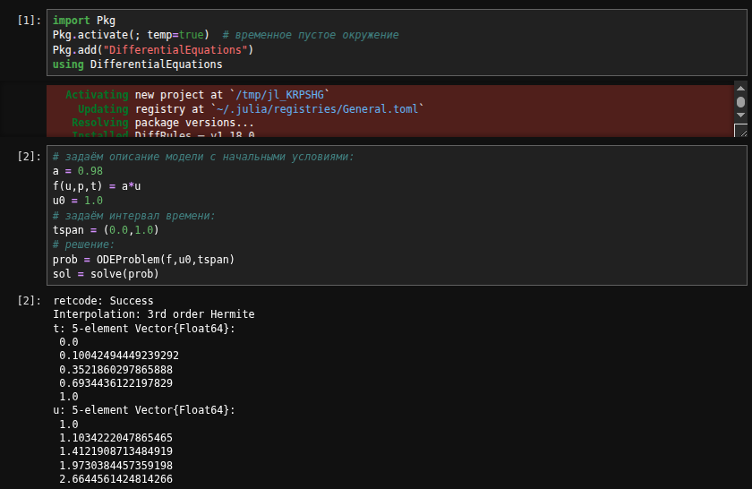{#fig-001 width=50%}

## Модель экспоненциального роста

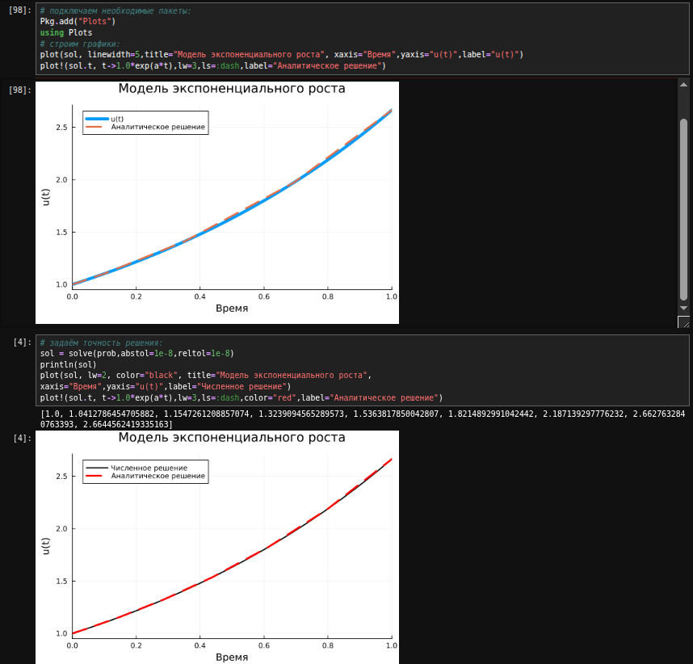{#fig-002 width=50%}

## Система Лоренца

Изучив теорию реализовали примеры, приведённые в тексте лабораторной работы, из раздела про систему Лоренца ([рис. @fig-003]), ([рис. @fig-004])

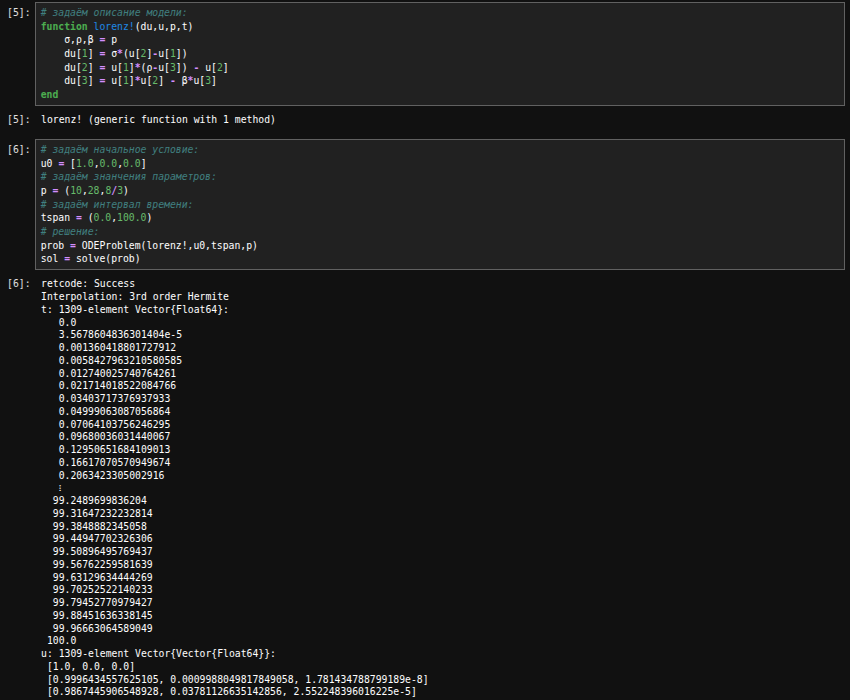{#fig-003 width=40%}

## Система Лоренца

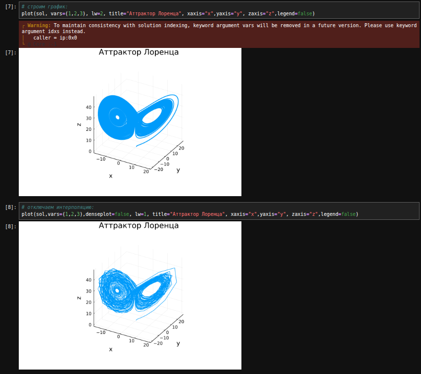{#fig-004 width=50%}

## Модель Лотки–Вольтерры

Изучив теорию реализовали примеры, приведённые в тексте лабораторной работы, из раздела про простой точечный график ([рис. @fig-005]), ([рис. @fig-006])

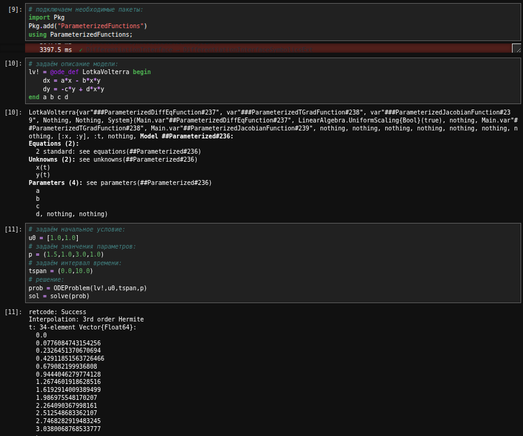{#fig-005 width=40%}

## Модель Лотки–Вольтерры

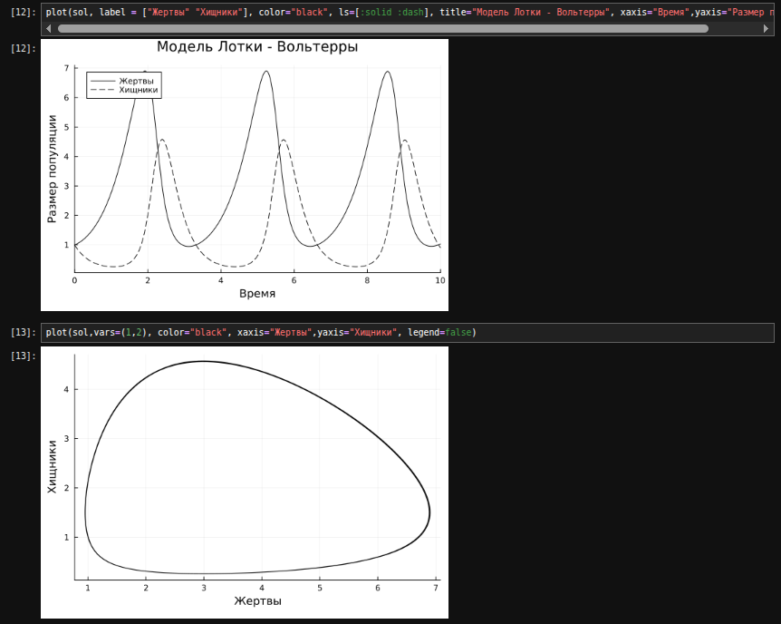{#fig-006 width=60%}

## Задания для самостоятельного выполнения. Задание №1

Реализовать и проанализировать модель роста численности изолированной популяции (модель Мальтуса): $$\dot{x} = ax, \quad a = b - c,$$

где $x(t)$ - численность изолированной популяции в момент времени $t$, $a$ - коэффициент роста популяции, $b$ - коэффициент рождаемости, $c$ -  коэффициент смертности. Начальные данные и параметры задать самостоятельно и пояснить их выбор. Построить соответствующие графики (в том числе с анимацией)

## Задания для самостоятельного выполнения. Задание №1

Выполнили задание №1 ([рис. @fig-007]), ([рис. @fig-008]), ([рис. @fig-009])

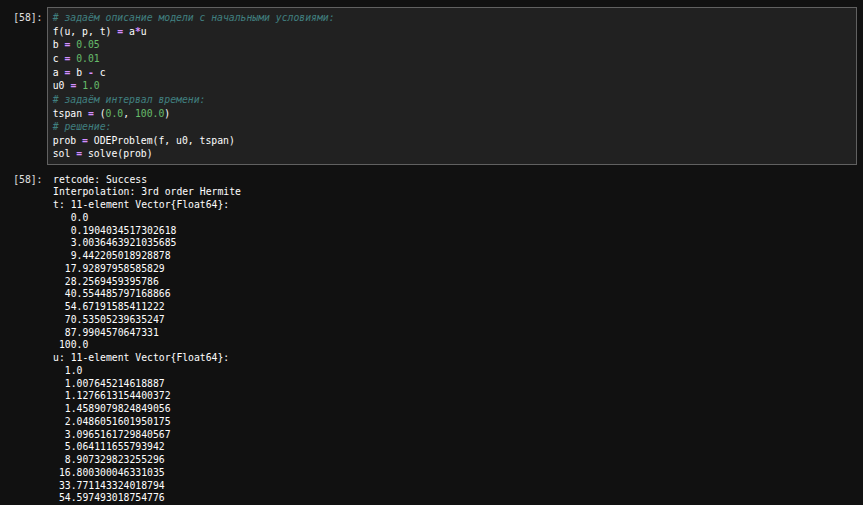{#fig-007 width=70%}

## Задания для самостоятельного выполнения. Задание №1

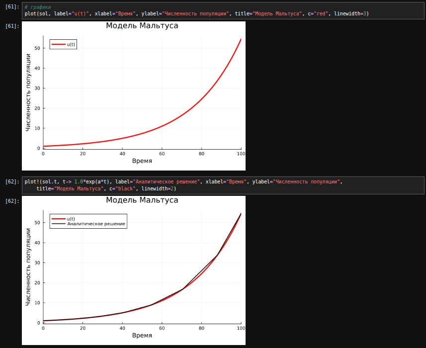{#fig-008 width=60%}

## Задания для самостоятельного выполнения. Задание №1

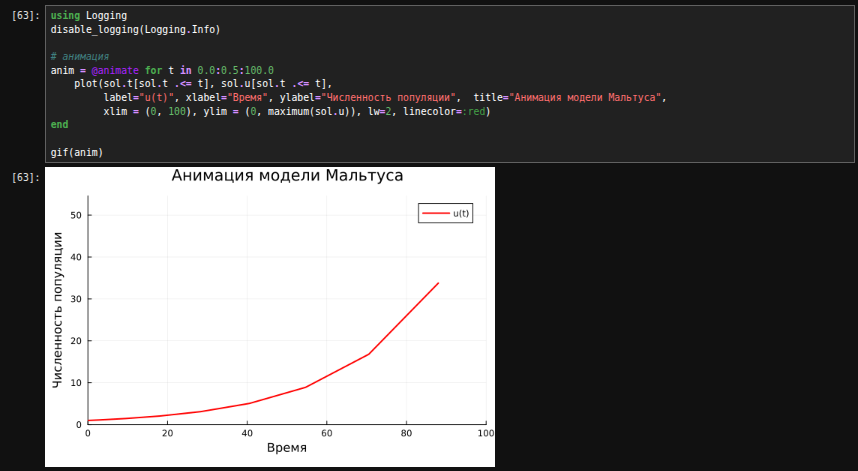{#fig-009 width=70%}

## Задания для самостоятельного выполнения. Задание №2

Реализовать и проанализировать логистическую модель роста популяции, заданную уравнением: $$\dot{x} = rx\left(1 - \frac{x}{k}\right), \quad r > 0, \quad k > 0,$$  

где $r$ - коэффициент роста популяции, $k$ - потенциальная ёмкость экологической системы (предельное значение численности популяции). Начальные данные и параметры задать самостоятельно и пояснить их выбор. Построить соответствующие графики (в том числе с анимацией)

## Задания для самостоятельного выполнения. Задание №2

Выполнили задание №2 ([рис. @fig-010]), ([рис. @fig-011]), ([рис. @fig-012])

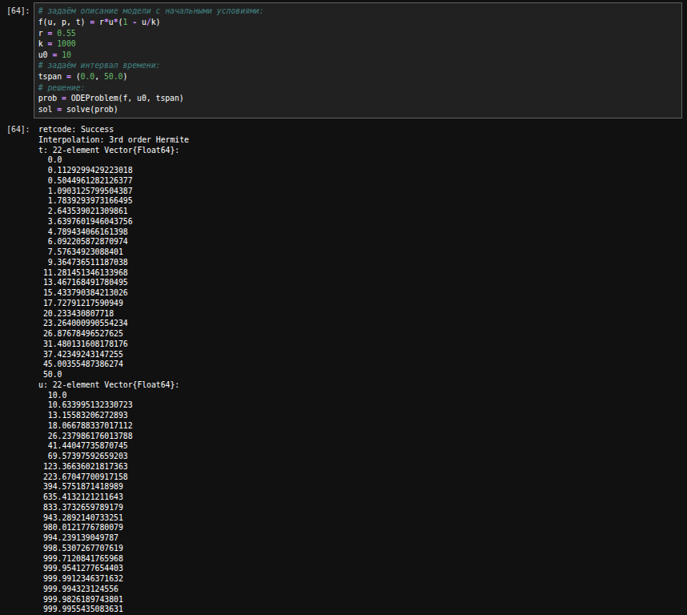{#fig-010 width=45%}

## Задания для самостоятельного выполнения. Задание №2

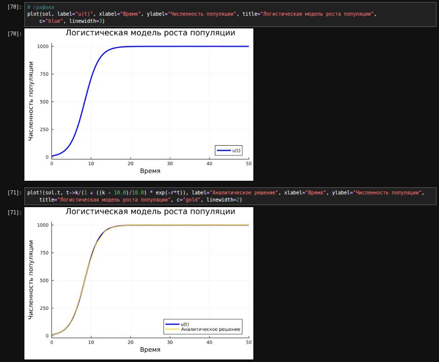{#fig-011 width=50%}

## Задания для самостоятельного выполнения. Задание №2

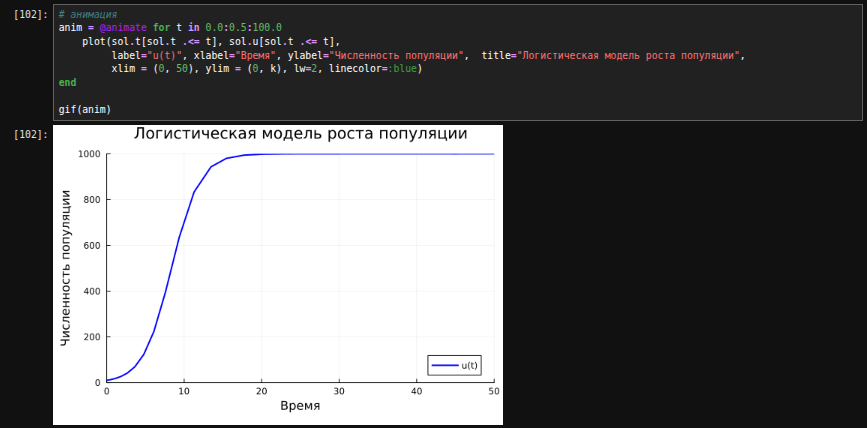{#fig-012 width=70%}

## Задания для самостоятельного выполнения. Задание №3

Реализовать и проанализировать модель эпидемии Кермака–Маккендрика (SIR-модель): 

$$
\begin{cases}
\dot{s} = -\beta i s, \\
\dot{i} = \beta i s - \nu i, \\
\dot{r} = \nu i,
\end{cases}
$$

## Задания для самостоятельного выполнения. Задание №3

Выполнили задание №3 ([рис. @fig-013]), ([рис. @fig-014])

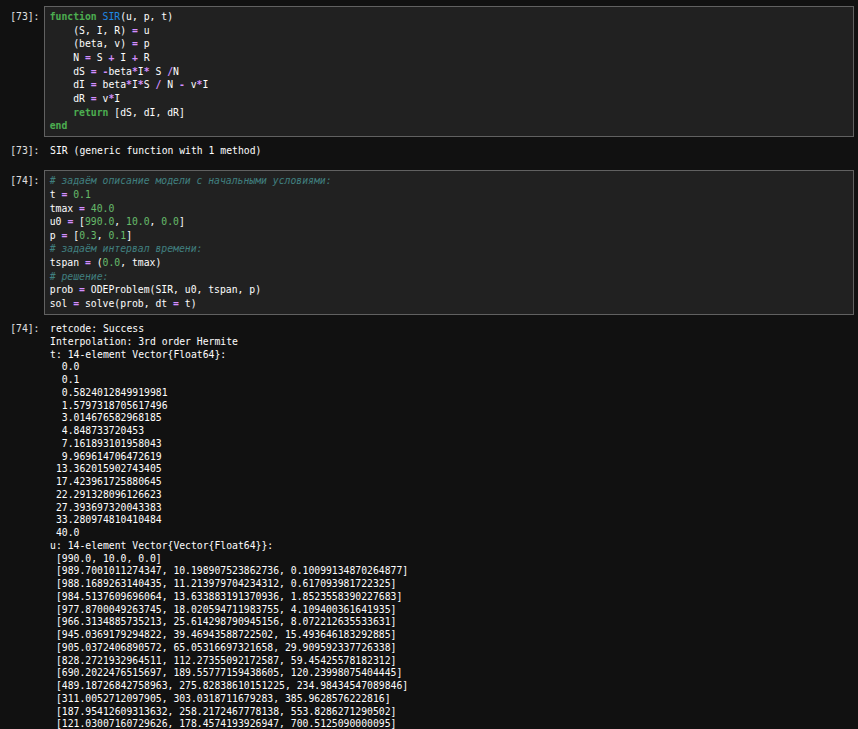{#fig-013 width=50%}

## Задания для самостоятельного выполнения. Задание №3

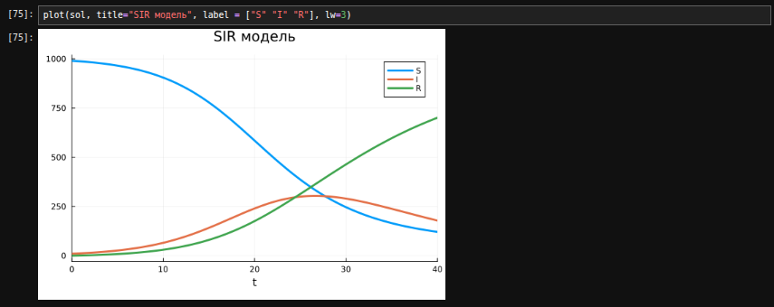{#fig-014 width=70%}

## Задания для самостоятельного выполнения. Задание №4

Как расширение модели SIR (Susceptible-Infected-Removed) по результатом эпидемии испанки была предложена модель SEIR (Susceptible-Exposed-Infected-Removed): 

$$
\begin{cases}
\dot{s}(t) = -\frac{\beta}{N} s(t) i(t), \\
\dot{e}(t) = \frac{\beta}{N} s(t) i(t) - \delta e(t), \\
\dot{i}(t) = \delta e(t) - \gamma i(t), \\
\dot{r}(t) = \gamma i(t)
\end{cases}
$$

Размер популяции сохраняется: $$s(t) + e(t) + i(t) + r(t) = N$$

Исследуйте, сравните с SIR.

## Задания для самостоятельного выполнения. Задание №4

Выполнили задание №4 ([рис. @fig-015]), ([рис. @fig-016])

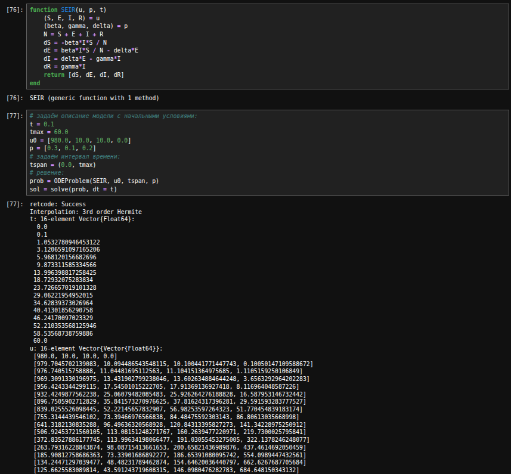{#fig-015 width=45%}

## Задания для самостоятельного выполнения. Задание №4

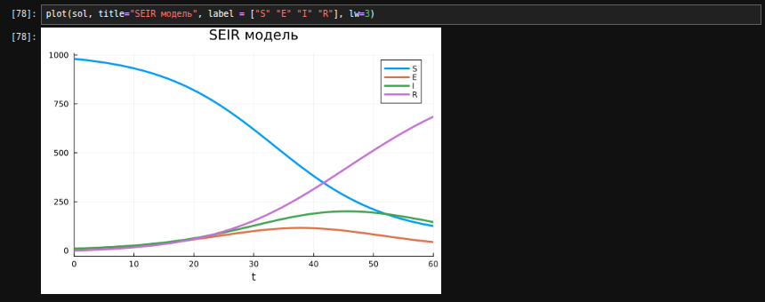{#fig-016 width=70%}

## Задания для самостоятельного выполнения. Задание №5

Для дискретной модели Лотки–Вольтерры: 

$$
\begin{cases}
X_1(t+1) = aX_1(t)(1 - X_1(t)) - X_1(t)X_2(t), \\
X_2(t+1) = -cX_2(t) + dX_1(t)X_2(t)
\end{cases}
$$

с начальными данными $a = 2, c = 1, d = 5$ найдите точку равновесия. Получите и сравните аналитическое и численное решения. Численное решение изобразите на фазовом портрете

## Задания для самостоятельного выполнения. Задание №5

Выполнили задание №5 ([рис. @fig-017]), ([рис. @fig-018])

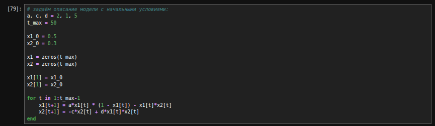{#fig-017 width=70%}

## Задания для самостоятельного выполнения. Задание №5

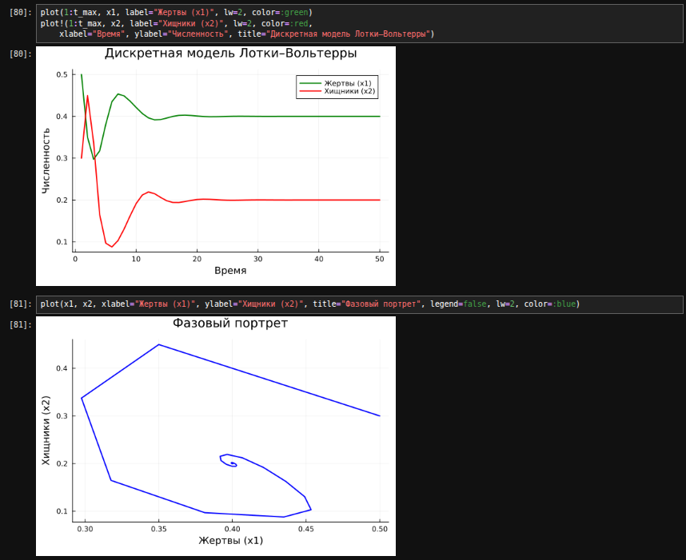{#fig-018 width=60%}

## Задания для самостоятельного выполнения. Задание №6

Реализовать на языке Julia модель отбора на основе конкурентных отношений: 

$$
\begin{cases}
\dot{x} = \alpha x - \beta xy, \\
\dot{y} = \alpha y - \beta xy
\end{cases}
$$

Начальные данные и параметры задать самостоятельно и пояснить их выбор. Построить соответствующие графики (в том числе с анимацией) и фазовый портрет

## Задания для самостоятельного выполнения. Задание №6

Выполнили задание №6 ([рис. @fig-019]), ([рис. @fig-020]), ([рис. @fig-021])

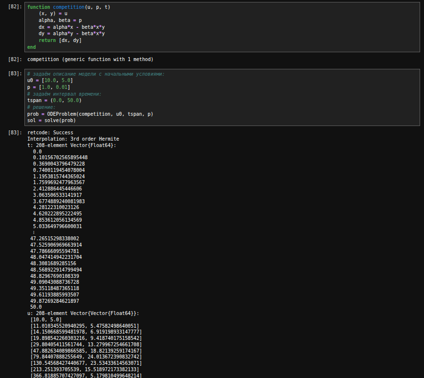{#fig-019 width=50%}

## Задания для самостоятельного выполнения. Задание №6

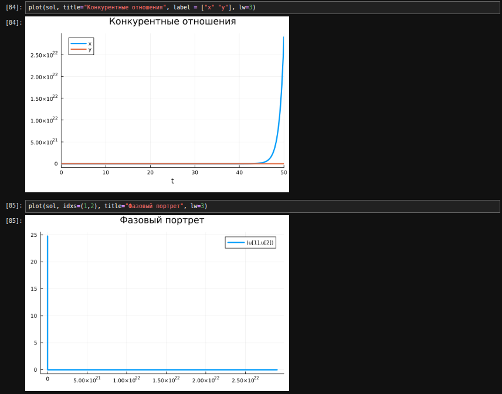{#fig-020 width=60%}

## Задания для самостоятельного выполнения. Задание №6

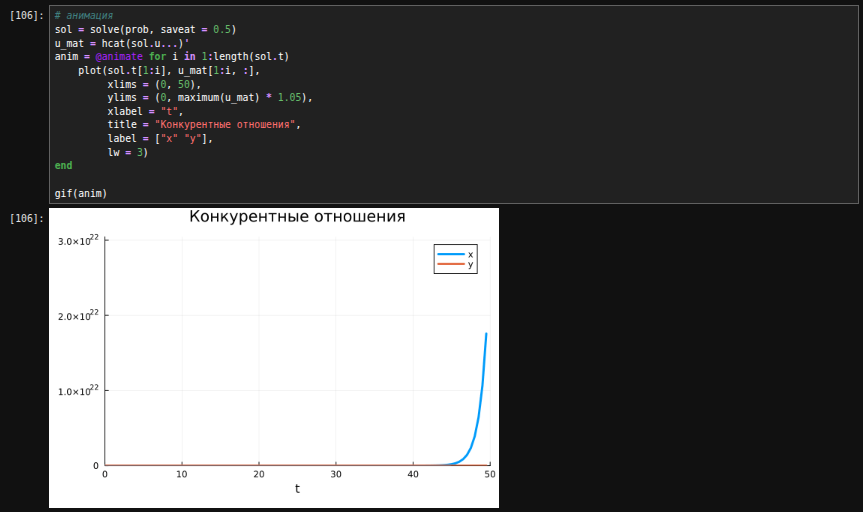{#fig-021 width=70%}

## Задания для самостоятельного выполнения. Задание №7

Реализовать на языке Julia модель консервативного гармонического осциллятора $$\ddot{x} + \omega_0^2 x = 0, \quad x(t_0) = x_0, \quad \dot{x}(t_0) = y_0,$$

где $\omega_0$ - циклическая частота. Начальные параметры подобрать самостоятельно, выбор пояснить. Построить соответствующие графики (в том числе с анимацией) и фазовый портрет

## Задания для самостоятельного выполнения. Задание №7

Выполнили задание №7 ([рис. @fig-022]), ([рис. @fig-023]), ([рис. @fig-024])

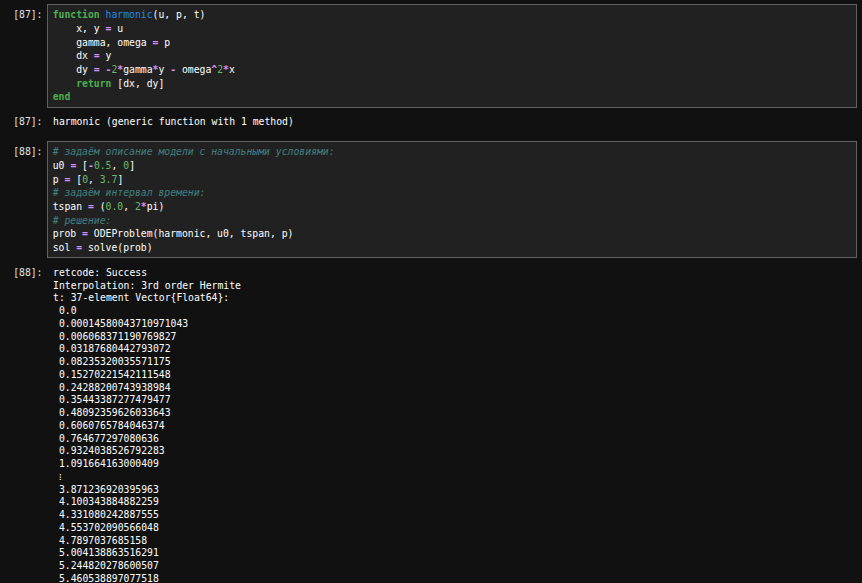{#fig-022 width=60%}

## Задания для самостоятельного выполнения. Задание №7

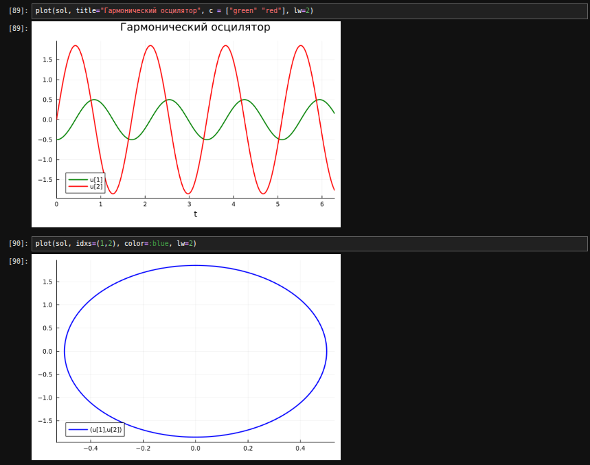{#fig-023 width=60%}

## Задания для самостоятельного выполнения. Задание №7

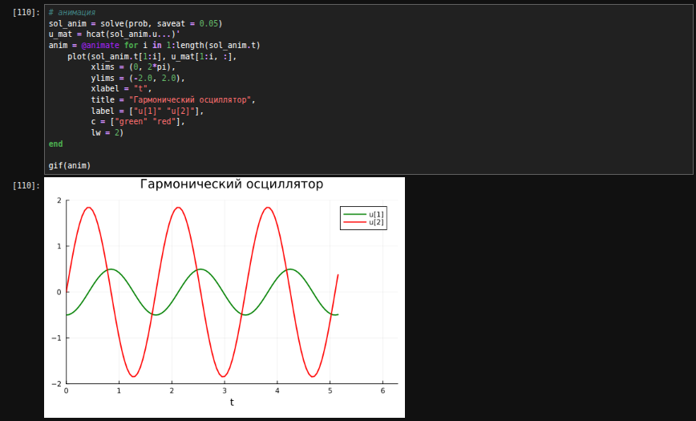{#fig-024 width=70%}

## Задания для самостоятельного выполнения. Задание №8

Реализовать на языке Julia модель свободных колебаний гармонического осциллятора $$\ddot{x} + 2\gamma \dot{x} + \omega_0^2 x = 0, \quad x(t_0) = x_0, \quad \dot{x}(t_0) = y_0,$$

где $\omega_0$ - циклическая частота, $\gamma$ - параметр, характеризующий потери энергии.
Начальные параметры подобрать самостоятельно, выбор пояснить. Построить соответствующие графики (в том числе с анимацией) и фазовый портрет

## Задания для самостоятельного выполнения. Задание №8

Выполнили задание №8 ([рис. @fig-025]), ([рис. @fig-026]), ([рис. @fig-027])

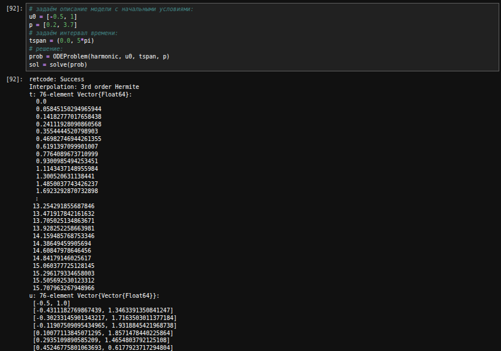{#fig-025 width=60%}

## Задания для самостоятельного выполнения. Задание №8

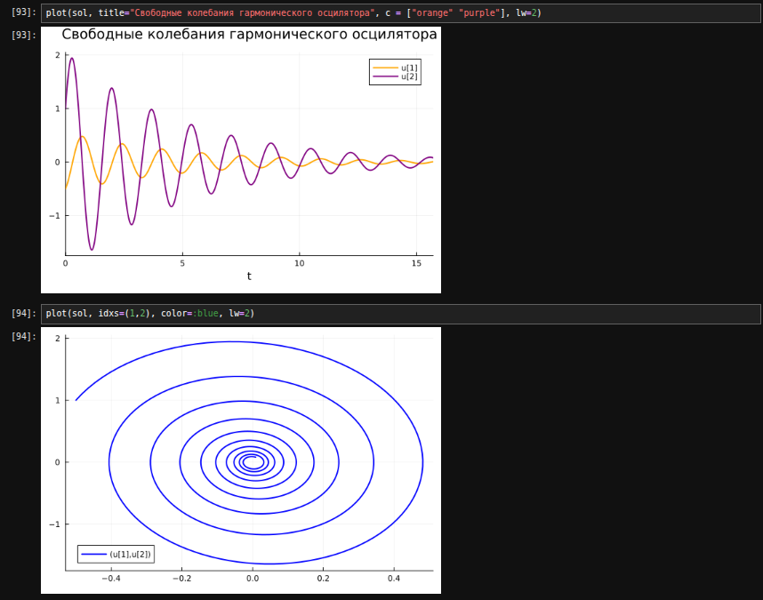{#fig-026 width=60%}

## Задания для самостоятельного выполнения. Задание №8

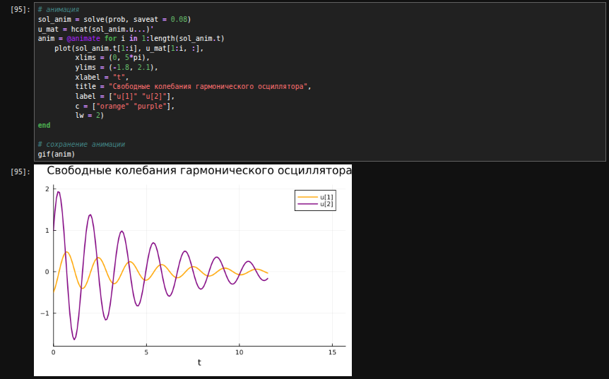{#fig-027 width=70%}

# Подведение итогов

## Выводы

В ходе выполнения лабораторной работы №6 мы освоили специализированные пакеты для решения
задач в непрерывном и дискретном времени

## Список литературы

1. [Лаборатораня работа №6](https://esystem.rudn.ru/pluginfile.php/3319665/mod_resource/content/2/006-lab_f_du.pdf)
